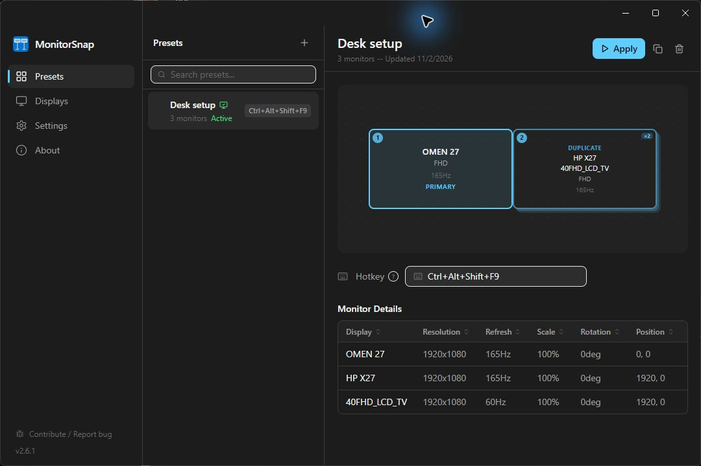
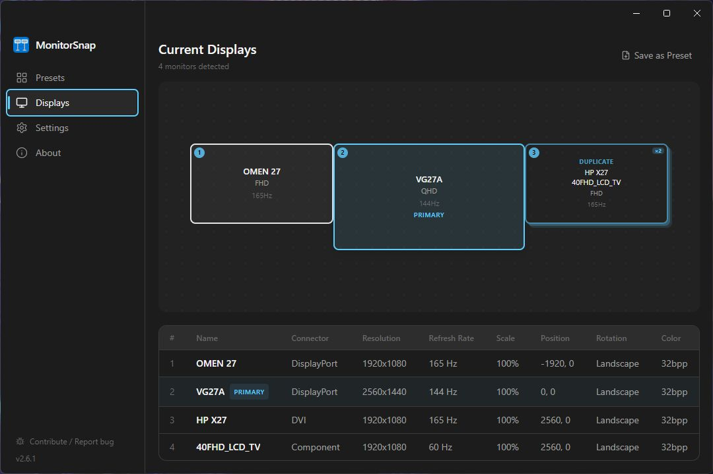
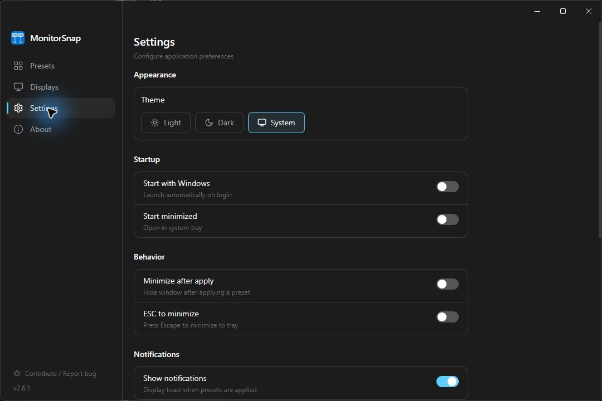

<div align="center">


# MonitorSnap

**Your monitor layouts, one click away.**

Save and restore Windows display configurations from a desktop app, a tray menu, or a global hotkey.
Made for KVM switches, docking stations, and multi-monitor desks.

[](https://github.com/GTRows/MonitorSnap/releases/latest)
[](LICENSE)
[](#download)

[Download for Windows](https://github.com/GTRows/MonitorSnap/releases/latest) · [Getting started](#getting-started) · [Report a bug](https://github.com/GTRows/MonitorSnap/issues) · [Contribute](CONTRIBUTING.md)



Free and open source. MIT licensed. No account required.

</div>

## Why MonitorSnap?

Switching a KVM or reconnecting a dock can leave Windows with the wrong primary display, positions, or refresh rates. MonitorSnap lets you save a known layout and reapply it when you need it.

- **KVM desks:** restore your preferred display configuration after switching computers.
- **Work and gaming:** keep separate presets for the layouts you use throughout the day.
- **Docks and TVs:** save configurations for your desk monitors and other connected screens.

MonitorSnap configures displays. It does not save or restore individual application window positions, switch a physical KVM, or connect disconnected monitors.

## Download

Get the files from [GitHub Releases](https://github.com/GTRows/MonitorSnap/releases/latest).
Windows 10 or 11, x64. The downloads include the backend; you do not need Python or Node.js installed.

| Package | Choose this if... |
| --- | --- |
| **Installer** - `MonitorSnap-Setup-<version>.exe` | You want a regular installation with a Start Menu entry and an uninstaller. Recommended for most users. |
| **MSI** - `MonitorSnap-<version>.msi` | You need a Windows Installer package for managed deployment. |
| **Portable** - `MonitorSnap-Portable-<version>.exe` | You want a single executable with its data in a `MonitorSnapData` folder beside it. Keep it in a writable folder. |
| **ZIP** - `MonitorSnap-<version>-win.zip` | You prefer to extract the application folder and run `MonitorSnap.exe` without an installer. Settings use AppData. |

The release binaries are not code signed. Windows SmartScreen may show an unknown-publisher warning. Check that your download came from this repository's Releases page before deciding whether to run it.

## Getting started

### 1. Save a layout you already use

Arrange your monitors in **Windows Settings > System > Display**. Choose the primary display, extend or duplicate screens, and set the resolutions and refresh rates you want.

Open MonitorSnap, go to **Presets**, and click **+** or **Save current config**. Give the layout a recognizable name, such as `Work desk`, and confirm. Select the saved preset to see its layout and monitor details.

### 2. Save your other setups

Change your display configuration in Windows, then save it as another preset. Each preset captures the configuration at the time you save it.

### 3. Restore a preset

Select a preset and click **Apply**. You can also right-click the MonitorSnap tray icon and choose a preset under **Quick Apply**.

Connect the displays used by the preset and let Windows finish detecting them first. Screens may briefly go blank while Windows changes the configuration.

### 4. Add a global hotkey

Select a preset, click its **Hotkey** field, and press a combination such as `Ctrl+Alt+Shift+F9`. The shortcut works while MonitorSnap is running, including when its window is hidden in the tray. If a shortcut is unavailable or already in use, choose another combination.

### 5. Keep it within reach

In **Settings**, enable **Start with Windows** and **Start minimized** if you want MonitorSnap available in the tray after signing in. **Minimize after apply** hides the window after switching layouts. Closing the window keeps the app in the tray; use **Exit** in the tray menu to quit.

## See your displays at a glance

The **Displays** page shows the current layout, primary screen, resolutions, refresh rates, scale, and positions. Mirrored displays appear together in the canvas.



The screenshots show a real three-monitor configuration: one primary display and two mirrored displays.

## Make it fit your workflow

Choose a light, dark, or system theme; control startup and minimize behavior; adjust text size; and export or import presets from **Settings**.



**Layout editing is experimental.** To try the drag editor, enable **Settings > Beta Features > Edit preset layouts**. It adds editing controls to presets and the Displays page. For everyday use, configure displays in Windows and capture the result as a preset.

## Backups, privacy, and updates

- **Back up presets:** use **Settings > Data > Export**. Use **Import** to bring an exported file back into the app. Monitor identities are specific to your hardware; importing a preset does not make it suitable for a different desk.
- **Installed and ZIP builds:** data is stored in `%APPDATA%\MonitorSnap\`, including `presets`, `settings.json`, and `debug.log`.
- **Portable builds:** data is stored in `MonitorSnapData` beside the portable executable. Move that folder with the executable to keep your presets.
- **Local display control:** the Python backend listens on a random loopback port, `127.0.0.1`, and the Electron app talks to it locally.
- **Update checks:** the app contacts the GitHub Releases API after startup and when you check manually in **About**. Display presets stay on your machine; they are not sent with the update check. Updates are downloaded and installed manually.

## Troubleshooting

| Problem | What to try |
| --- | --- |
| A preset cannot find a display | Connect the original monitors, wait for detection, and try again. If cabling or hardware changed, capture a new preset. |
| The layout is wrong after docking or a KVM switch | Wait until Windows has detected all displays before applying the preset. |
| A hotkey does nothing | Keep MonitorSnap running and check the preset's shortcut status. Another application may own the combination. |
| A resolution or refresh rate cannot be restored | Confirm that Windows offers that mode for the current connection. GPU, cable, dock, and driver limits still apply. |
| Something else fails | Check `debug.log` in the data folder and [open an issue](https://github.com/GTRows/MonitorSnap/issues). Include your app version, Windows version, GPU, monitor connections, and reproduction steps. Review logs for private details before sharing them. |

MonitorSnap is Windows-only. Custom GPU modes and unusual display configurations may need additional testing. Display scale is shown in the UI; do not rely on presets to change Windows DPI scaling.

## Build from source

You need Windows, Python 3.10+, Node.js 20+, and Git for development.

```powershell
git clone https://github.com/GTRows/MonitorSnap.git
cd MonitorSnap
.\dev.bat
```

Or start the development app manually:

```powershell
cd electron-app
npm ci
npm run electron:dev
```

Electron starts the Python backend automatically. To run only the backend, use `python -m display_presets.server` from the repository root.

### Checks

From the repository root:

```powershell
python -m pip install pytest
python -m pytest tests/ -q
cd electron-app
npm test
npm run build
```

### Release builds

The [release workflow](.github/workflows/release.yml) builds the standalone Python backend with PyInstaller, bundles it into Electron, and produces Installer, MSI, Portable, and ZIP downloads. Use the workflow as the reference for packaging; `npm run electron:build` requires the backend executable to exist first. MSI packaging also requires WiX and `electron-wix-msi`.

### CLI

The source package includes a command-line interface for scripts. From the repository root:

```powershell
python -m display_presets current
python -m display_presets save "Work desk"
python -m display_presets list
python -m display_presets apply "Work desk"
python -m display_presets --help
```

The CLI uses name-based preset files; the desktop app uses UUID-based preset files. They are separate workflows. For desktop presets, use the app's own save, apply, export, and import controls.

### Under the hood

Electron + React + TypeScript provide the interface. A Python standard-library backend uses `ctypes` to call the Windows Display Configuration API (`QueryDisplayConfig` / `SetDisplayConfig`). Applying a preset restores topology first, then modes and positions.

## Contributing

Bug reports, hardware compatibility feedback, documentation improvements, and pull requests are welcome. Start with [CONTRIBUTING.md](CONTRIBUTING.md) for setup and contribution guidelines, and [ROADMAP.md](ROADMAP.md) for future ideas.

Please [report security vulnerabilities privately](SECURITY.md). Community participation follows the [Code of Conduct](CODE_OF_CONDUCT.md).

## License

[MIT](LICENSE). Free to use, modify, and share.
